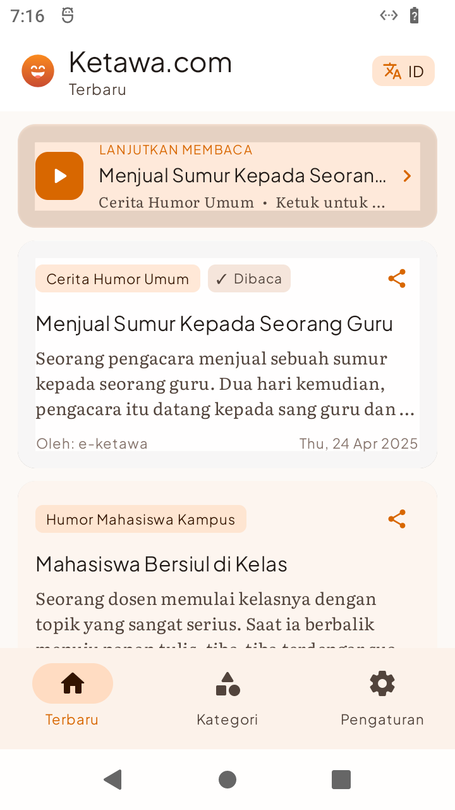
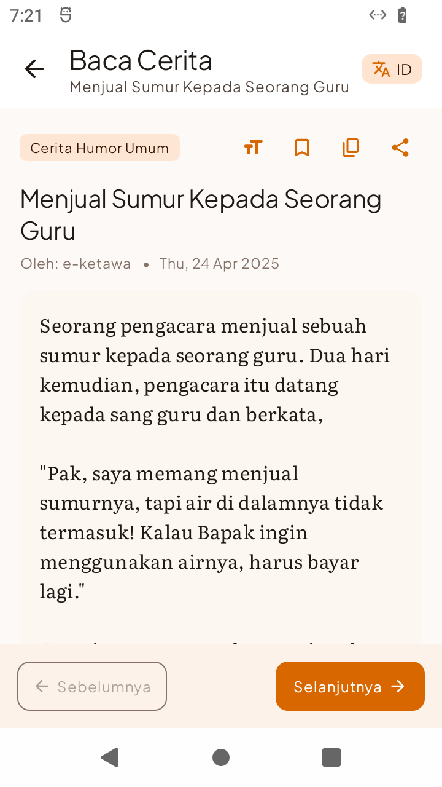
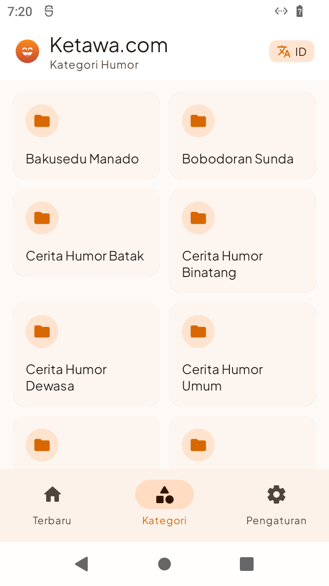
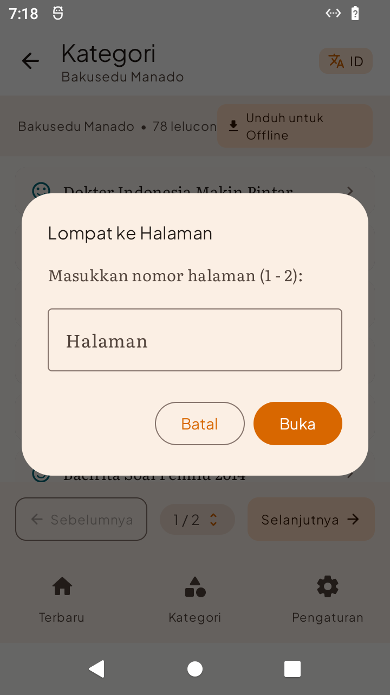
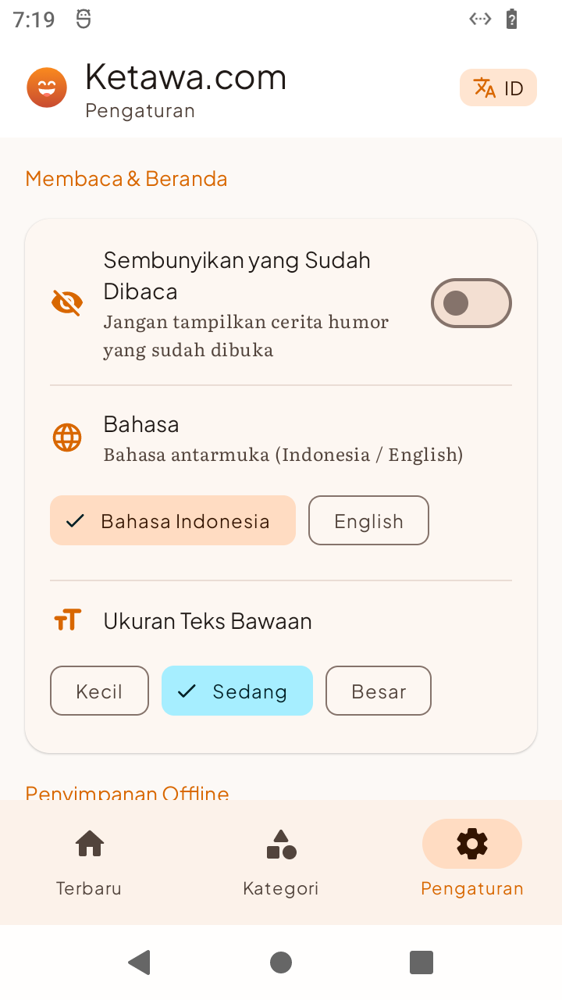

<div align="center">


# Ketawa Reader

**A modern, distraction-free, offline-first Android client for [Ketawa.com](https://www.ketawa.com)**  
*Indonesia's legendary humor and satire archive, redesigned for modern Android.*

[](https://kotlinlang.org)
[](https://developer.android.com/jetpack/compose)
[](https://developer.android.com/topic/architecture)
[](https://developer.android.com/training/data-storage/room)
[](LICENSE)

</div>

---

## Overview

**Ketawa Reader** is a high-performance Android application built from the ground up using **100% Jetpack Compose** and modern Android development standards. It connects to the classic `Ketawa.com` humor API, providing a clean, accessible reading experience with offline database sync, smart background prefetching, customizable typography, and full dual-language internationalization (Indonesian & English).

---

## Screenshots

| Home Feed & Resume Card | Immersive Reader Mode |
| :---: | :---: |
|  |  |

| 2-Column Categories Grid | Direct Page Jump Dialog | Settings & Offline Cache |
| :---: | :---: | :---: |
|  |  |  |

---

## Key Features

### 🎭 Brand Identity & UI Design
* **Custom Brand Emblem:** Radiant warm citrus-to-terracotta gradient (`#FA8A1E` → `#C84B31`) with cheerful smiling face iconography.
* **Full Iconography System:** Native Android adaptive vector icons (`ic_launcher.xml`, `ic_launcher_round.xml`) plus pre-rendered multi-density raster assets (`mdpi` through `xxxhdpi`) and a 512×512 Google Play store asset.
* **Editorial Material 3 Palette:** Clean cards, comfortable touch targets, and subtle elevation built strictly with Jetpack Compose components.

### 📖 Reader Ergonomics & Immersive Mode
* **Editorial Typography:** Bundled variable offline fonts — **Plus Jakarta Sans** for UI chrome and headers, paired with **Literata** serif for reading body text.
* **Distraction-Free Auto-Hide:** Opening a joke automatically collapses the 3-tab bottom navigation bar (`0dp` inset) to maximize vertical reading area.
* **Single-Touch Toggle:** Tapping anywhere on the story canvas smoothly animates the bottom navigation bar into view (`slideInVertically` + `fadeIn`). Tapping again hides it.
* **On-the-Fly Font Scaling:** Instant toggle between `Small` (14sp), `Medium` (15.5sp), and `Large` (18sp) reading scales.
* **Utility Toolbar:** One-tap clipboard copy, native Android share sheet integration, and bookmarking.

### ⚡ Smart Prefetching & Instant Transitions
* **Lookahead Cache Engine:** When reading joke $N$, the background worker automatically prefetches joke $N+1$, $N+2$, and $N-1$ directly into local Room SQLite.
* **0ms Navigation:** Tapping **"Selanjutnya"** (Next) or **"Sebelumnya"** (Previous) hits SQLite cache synchronously, delivering immediate transitions without network spinners.

### 🔖 Read Tracking & Resume Banner
* **Persistent Read History:** Automatically marks jokes as read upon opening via AndroidX DataStore preferences.
* **Feed Badges:** Visual `✓ Dibaca` (ID) / `✓ Read` (EN) badges on joke cards with dimmed containers for read items.
* **Resume Reading Banner:** The home feed surfaces an interactive `LANJUTKAN MEMBACA` banner showing the last opened joke, category, and a one-tap jump to resume reading.
* **Feed Filters:** Optional toggle in Settings to hide already-read jokes from the main feed.

### 🌐 Dual-Language Runtime i18n
* **Bilingual Support:** Complete localization for **Bahasa Indonesia** and **English**.
* **Instant Switching:** One-tap `[ ID | EN ]` pill in the top app bar switches strings instantly without restarting the application.
* **Full Coverage:** Nav tabs, error banners, settings controls, dialogs, and button labels adapt automatically.

### 💾 Offline-First Architecture & Storage Manager
* **Single Source of Truth:** Repository emits cached Room SQLite entities before reconciling with remote HTTP endpoints.
* **Category Batch Downloader:** Pre-download entire humor categories (e.g. *Abu Nawas*, *Humor Mahasiswa*, *SMS Lucu*) for completely air-gapped reading.
* **Storage Dashboard:** Real-time offline database counts, individual cache clearing, and read history reset tools in Settings.

### 🗂️ Categories & Direct Page Jumping
* **2-Column Responsive Grid:** Browse humor topics with folder badges and clean spacing.
* **Modal Page Jumping:** Clickable pagination pill (`[ 1 / N ▾ ]`) triggers a numeric jump dialog with boundary validation, eliminating linear page tapping.

---

## Architecture & Tech Stack

```
app/
├── data/
│   ├── local/              # Room Database, DAOs, Entities & DataStore Preferences
│   ├── remote/             # Ktor HTTP Client & API DTOs
│   └── repository/         # Single-source-of-truth Repository implementation
├── domain/
│   ├── model/              # Pure Kotlin domain entities
│   └── repository/         # Repository contracts
├── feature/
│   ├── home/               # Latest jokes feed, Resume Reading card & view models
│   ├── category/           # Categories grid, category feed & jump-to-page dialog
│   ├── post/               # Immersive reader, prefetching engine & typography
│   └── settings/           # Preferences, theme, language & storage controls
├── presentation/
│   ├── components/         # NavTopBar, NavigationBottomBar, NavHost & Scaffold
│   └── theme/              # Material 3 Color Schemes & Type definitions
└── utils/                  # Resource wrappers & HTML sanitizers
```

| Layer | Technologies |
| :--- | :--- |
| **Language** | Kotlin 2.0.21 |
| **UI Toolkit** | Jetpack Compose (BOM 2024.09.00), Material 3 |
| **Async & Reactive** | Kotlin Coroutines, StateFlow, SharedFlow |
| **Local Database** | Room SQLite 2.6.1 (KSP) |
| **Key-Value Storage** | AndroidX Preferences DataStore |
| **Networking** | Ktor Client 2.3.12 (CIO Engine) |
| **Serialization** | `kotlinx.serialization` (JSON) |
| **Dependency Injection** | Dagger Hilt 2.51.1 |
| **Fonts** | Bundled Google Fonts: Plus Jakarta Sans & Literata |

---

## Getting Started

### Prerequisites
* **Java Development Kit:** OpenJDK 21
* **Android SDK:** Platform 34 (`android-34`), Build Tools `34.0.0`
* **Gradle:** Wrapper bundled (Gradle 8.7+)

### Building from Source

1. Clone the repository:
   ```bash
   git clone https://github.com/wongpinter/ketawa-reader-app.git
   cd ketawa-reader-app
   ```

2. Configure SDK path in `local.properties`:
   ```properties
   sdk.dir=/path/to/your/android-sdk
   ```

3. Build the debug APK:
   ```bash
   ./gradlew assembleDebug
   ```
   The compiled APK will be located at:
   ```
   app/build/outputs/apk/debug/app-debug.apk
   ```

4. Install to a connected device or emulator:
   ```bash
   adb install -r app/build/outputs/apk/debug/app-debug.apk
   ```

---

## API Endpoints Used

Powered by the public endpoints at `https://api.ketawa.com`:
* `GET /json-index`: Latest humor feed.
* `GET /json-cat-list`: Category directory.
* `GET /json-cat-{catId}-{page}`: Paginated jokes by category.
* `GET /json-detail-{id}`: Full joke content and navigation pointers.

---

## License

This project is licensed under the [MIT License](LICENSE).
